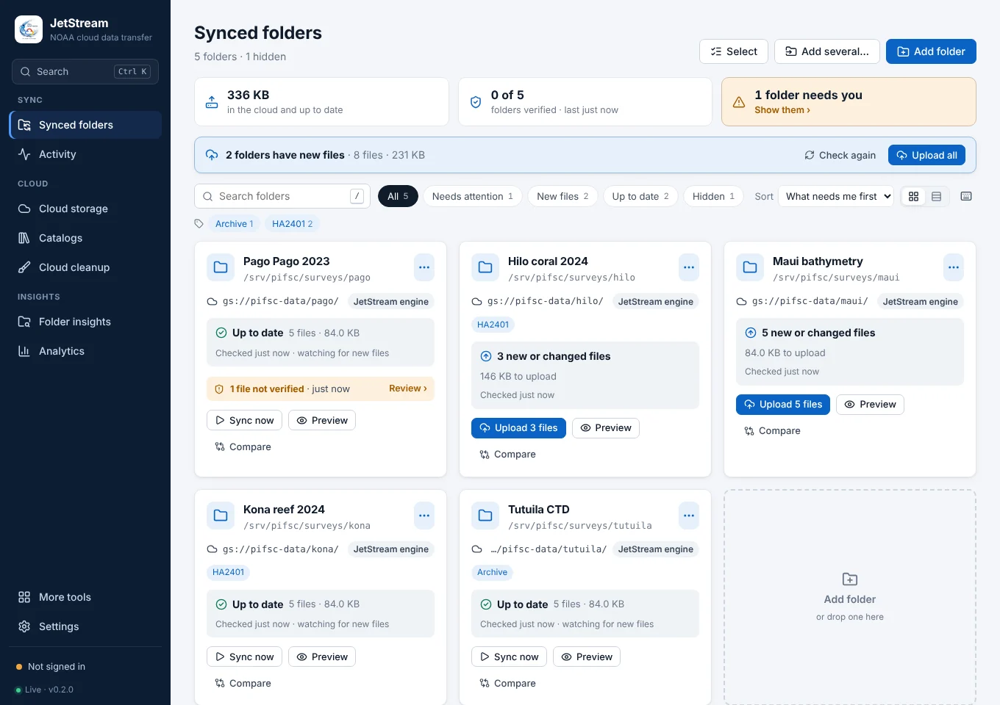

# NOAA JetStream Desktop

**The standalone, click-to-run desktop application for moving research data to Google Cloud Storage.**

JetStream Desktop takes the powerful data-transfer engine of the [original JetStream](https://github.com/MichaelAkridge-NOAA/jetstream) project and bundles it into a seamless, native desktop application. 

Move massive amounts of research data from your local computer or network shares directly to the cloud—without ever touching a command line.

---

## ⚡ JetStream vs. JetStream Desktop

If you are familiar with the original NOAA JetStream, you know it requires installing Python, setting up Anaconda environments, and running terminal commands to host a local web server. 

**JetStream Desktop is the "Easy Mode" alternative.**
It packages the exact same robust transfer engine and dashboard into a standard, double-click executable (`.exe`, macOS App, or Linux binary). 
* **No Python required.** 
* **No Conda environments.** 
* **No terminal commands to start the app.** 

Just install the app, log in, and start syncing. *(Note: You will still need the [Google Cloud SDK](https://cloud.google.com/sdk/docs/install) installed on your machine for Google authentication).*

---

## ✨ Key Features

* **Drag-and-Drop Easy:** Select local folders and map them directly to your Google Cloud Storage buckets.
* **Smart Syncing:** Sync folders on demand or on a set schedule. Easily preview, pause, and resume your data transfers.
* **Cloud Management:** Browse your cloud storage, compare your local files against remote folders, and generate comprehensive data catalogs.
* **Peace of Mind:** Review detailed activity logs, monitor live upload progress, and verify file integrity with checksum verification receipts.
* **Fully Portable:** Use standard installers for Windows, macOS, or Linux—or run Windows/Linux portable builds with self-contained data folders.

---

## 🚀 Quick Start Guide

**1. Download & Install**
Grab the latest Windows, macOS, or Linux installer from the [Releases page](https://github.com/MichaelAkridge-NOAA/jetstream-desktop/releases). Check the [installation guide](website/docs/download.md) for platform-specific requirements and unsigned-build warnings.

**2. Authenticate Google Cloud**
Ensure the [Google Cloud SDK](https://cloud.google.com/sdk/docs/install) is installed. Open your system's terminal/command prompt and run `gcloud auth login` with an account that has permission to access your target bucket.

**3. Launch & Sync**
Open JetStream Desktop. Add a local folder, preview your planned file changes, and click upload! Read the full [First Upload Guide](website/docs/getting-started.md) for a detailed walkthrough.

---

## 📚 [Documentation & Support](https://michaelakridge-noaa.github.io/jetstream-desktop/)

Need more details? Check out our documentation:

* **[User Guide, Troubleshooting & Manuals](https://michaelakridge-noaa.github.io/jetstream-desktop/**

*Looking for the headless web app, Python package, or Terminal UI (TUI) for remote servers? Check out the [Original JetStream Repository](https://github.com/MichaelAkridge-NOAA/jetstream).*

#### Disclaimer
This repository is a scientific product and is not official communication of the National Oceanic and Atmospheric Administration, or the United States Department of Commerce. All NOAA GitHub project content is provided on an 'as is' basis and the user assumes responsibility for its use. Any claims against the Department of Commerce or Department of Commerce bureaus stemming from the use of this GitHub project will be governed by all applicable Federal law. Any reference to specific commercial products, processes, or services by service mark, trademark, manufacturer, or otherwise, does not constitute or imply their endorsement, recommendation or favoring by the Department of Commerce. The Department of Commerce seal and logo, or the seal and logo of a DOC bureau, shall not be used in any manner to imply endorsement of any commercial product or activity by DOC or the United States Government.

## License
See the [LICENSE.md](./LICENSE.md) for details
