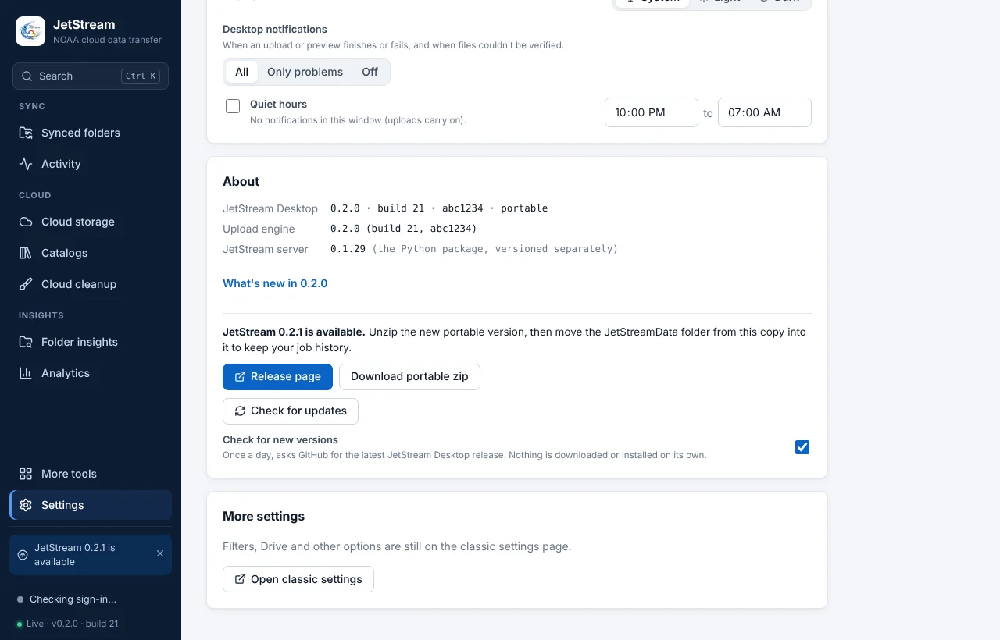

# Download and install

Published builds are available from the [desktop releases page](https://github.com/MichaelAkridge-NOAA/jetstream-desktop/releases). New versions built on `main` and manually tagged builds first create a draft release, which is not available until a maintainer publishes it.
When available, development builds can also be downloaded from [GitHub Actions](https://github.com/MichaelAkridge-NOAA/jetstream-desktop/actions/workflows/desktop.yml) (open a successful run and scroll to **Artifacts**). Windows and Linux portable builds have separate `-portable` artifacts; installers are in `-installers` artifacts. GitHub wraps each artifact in a ZIP, so unzip the artifact first to reach the portable ZIP.

## Windows

=== "Portable (recommended)"

    [Download the Windows portable ZIP from Releases](https://github.com/MichaelAkridge-NOAA/jetstream-desktop/releases)

    If no release is published yet, use the Windows portable artifact from a successful [Actions run](https://github.com/MichaelAkridge-NOAA/jetstream-desktop/actions/workflows/desktop.yml).

    1. Unzip it anywhere: your Documents folder, a shared drive, or a USB stick.
    2. Run **JetStream.exe**. Nothing is installed, and no administrator rights are needed.

    Job history, logs and the upload manifest stay in the **JetStreamData** folder next to the program, so the whole folder can travel with you.

=== "Installer"

    [Download a Windows installer from Releases](https://github.com/MichaelAkridge-NOAA/jetstream-desktop/releases) or use the Windows installers artifact from a successful [Actions run](https://github.com/MichaelAkridge-NOAA/jetstream-desktop/actions/workflows/desktop.yml).

    Adds JetStream to the Start menu. Data is kept in `%LOCALAPPDATA%\JetStream`.

!!! note "Windows protected your PC"
    JetStream isn't code-signed yet, so Windows SmartScreen (and sometimes Chrome) warns about it.
    Choose **More info → Run anyway**. Signing is planned.

Windows 10 and 11 include the WebView2 runtime JetStream needs.

## macOS

1. Download the macOS `.dmg` from [Releases](https://github.com/MichaelAkridge-NOAA/jetstream-desktop/releases) or a successful [Actions run](https://github.com/MichaelAkridge-NOAA/jetstream-desktop/actions/workflows/desktop.yml). Check that the build's architecture matches your Mac; CI builds for the runner's native architecture, not a universal binary.
2. Open the disk image and drag **JetStream** to **Applications**.
3. Open JetStream from Applications. Its data is kept in `~/Library/Application Support/JetStream`.

!!! note "macOS security warning"
    The build is unsigned and not notarized, so Gatekeeper may block it. Only proceed if you trust the source: after attempting to open JetStream, check **System Settings → Privacy & Security** for **Open Anyway**.

Apps opened from Finder may not inherit your shell's `PATH`. Install the Google Cloud SDK in a standard location such as `/usr/local/bin` or Homebrew, or start JetStream from a terminal with `open -a JetStream`.

## Linux

=== ".deb (Debian, Ubuntu)"

    [Download the Linux .deb from Releases](https://github.com/MichaelAkridge-NOAA/jetstream-desktop/releases) or use the Linux installers artifact from a successful [Actions run](https://github.com/MichaelAkridge-NOAA/jetstream-desktop/actions/workflows/desktop.yml).

    ```bash
    sudo apt install ./JetStream_<version>_amd64.deb
    ```

    Installs JetStream with what it needs (WebKitGTK 4.1). Ubuntu 22.04 or newer.

=== "AppImage (most distributions)"

    [Download the Linux AppImage from Releases](https://github.com/MichaelAkridge-NOAA/jetstream-desktop/releases) or use the Linux installers artifact from a successful [Actions run](https://github.com/MichaelAkridge-NOAA/jetstream-desktop/actions/workflows/desktop.yml).

    ```bash
    chmod +x JetStream_<version>_amd64.AppImage
    ./JetStream_<version>_amd64.AppImage
    ```

=== "Portable zip"

    [Download the Linux portable ZIP from Releases](https://github.com/MichaelAkridge-NOAA/jetstream-desktop/releases) or use the Linux portable artifact from a successful [Actions run](https://github.com/MichaelAkridge-NOAA/jetstream-desktop/actions/workflows/desktop.yml). Unzip it and run `./JetStream`.
    Needs WebKitGTK 4.1 (`sudo apt install libwebkit2gtk-4.1-0` on Ubuntu and Debian).

The tray icon needs a desktop with AppIndicator support (on GNOME, the AppIndicator extension).

## You'll also need

- **Google Cloud SDK** (`gcloud`) for signing in with your Google account: [install it](https://cloud.google.com/sdk/docs/install). JetStream tells you if it's missing.
- Access to a Google Cloud Storage bucket. See [For IT and admins](admins.md#permissions) for the permissions.

## Updating

JetStream checks once a day for a newer release and says so at the bottom of the sidebar and in **Settings → About**, with links to download it. Nothing is downloaded or installed on its own.

Windows and Linux portable copies with a known build number can also be offered a newer build of the same version when the matching ZIP is attached to a published release. Development builds in Actions are not checked. Installed and macOS copies are notified about newer versions only.

This check is unauthenticated and cannot see releases in a private repository. It requires a publicly accessible, published desktop release.

Older builds check the previous repository and may not see releases here. Download a newer build from the desktop releases page manually to move to the new update channel.

- **Installer:** run the new installer.
- **macOS:** open the new disk image and replace JetStream in Applications.
- **Portable:** unzip the new version, then move the **JetStreamData** folder from the old copy into it to keep your history.

Back up your data before updating. Drafts and prereleases do not appear in the app's update check.

After an update, JetStream shows **What's new** once.

{ .screen }
